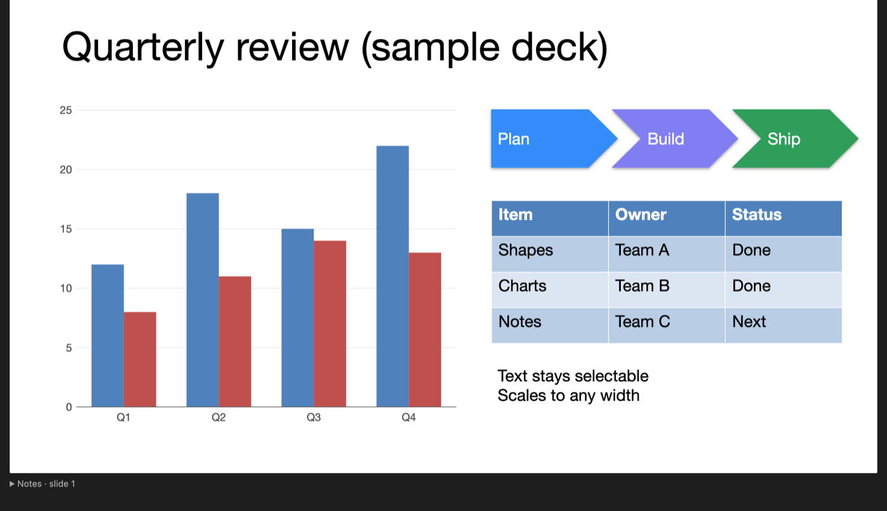
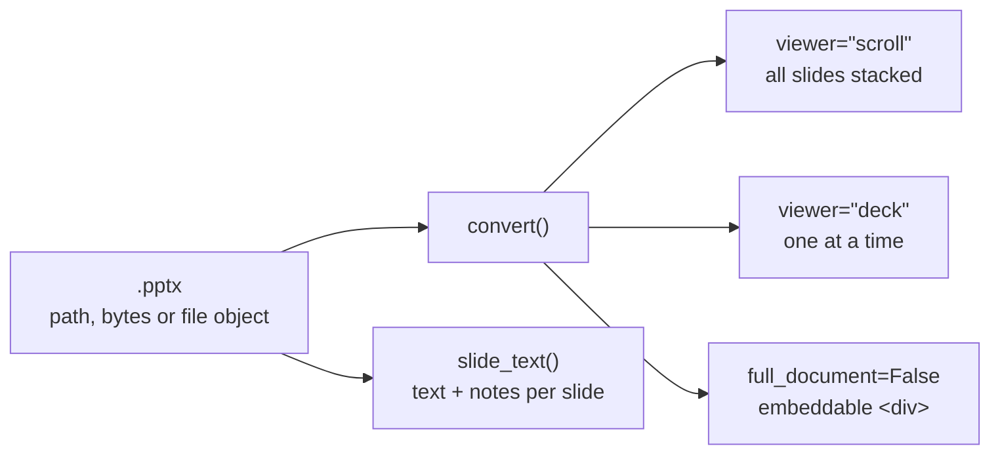
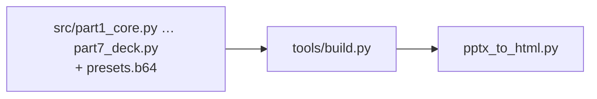

<div align="center">

# pptx-to-html

**Convert PowerPoint (`.pptx`) files to a single self-contained HTML file.**

[](LICENSE)
[](pptx_to_html.py)
[](https://pypi.org/project/python-pptx/)
[](#limits)



<sub>A sample slide (made for this README with python-pptx) after conversion, shown in Chrome. Chart, shapes and table are HTML and inline SVG.</sub>

</div>

Every slide is rendered as real HTML and inline SVG, so text stays selectable and the deck scales to any width.
No LibreOffice, no network access, no external files.

| 1 | 1 | 187 | 0 |
|:---:|:---:|:---:|:---:|
| Python file to copy | dependency (`python-pptx`) | preset shapes rendered | network calls or external files |



## Install

```
pip install python-pptx
```

Then copy `pptx_to_html.py` into your project. Requires Python 3.9+.

The only dependency is `python-pptx` (which brings `lxml`, `Pillow`, `XlsxWriter` and `typing_extensions`).

## Use

```python
from pptx_to_html import convert, slide_text

html = convert("deck.pptx")                      # path, bytes, or binary file object
html = convert("deck.pptx", viewer="deck")       # one slide at a time, Previous / Next
html = convert(data, full_document=False)        # embeddable <div> fragment
text = slide_text("deck.pptx")                   # [{"slide": 1, "text": ..., "notes": ...}, ...]
```

```
python pptx_to_html.py deck.pptx -o deck.html
python pptx_to_html.py deck.pptx --deck
```

Options for `convert`:

| Argument | Default | Meaning |
|---|---|---|
| `viewer` | `"scroll"` | `"scroll"` stacks all slides; `"deck"` shows one at a time with Previous / Next, arrow keys and a "Show all" toggle |
| `full_document` | `True` | `False` returns a `<div>` fragment with its own scoped styles |
| `notes` | `True` | Speaker notes as a collapsible section under each slide |
| `max_image_px` | `2400` | Large images are downscaled to this size |
| `max_width` | `"1280px"` | Maximum rendered slide width |
| `warnings` | `None` | Pass a list to collect non-fatal rendering notes |

## What it renders

| Area | Supported |
|---|---|
| Text | Theme fonts and colours, bullets, numbering, layout / master inheritance |
| Shapes | All 187 preset shapes, freeform shapes, lines, arrows, gradients, shadows, groups, rotation, flips |
| Images | Cropping and shape masks; EMF and WMF vector images are converted to SVG |
| Data | Tables (including table styles), charts (redrawn as SVG from cached data), SmartArt |
| Slides | Backgrounds, including theme image fills; speaker notes |

## Limits

- Images are embedded as data URIs, so photo-heavy decks produce large HTML.
- Fonts that are not installed on the viewer's machine fall back to a similar font, so line wraps can differ slightly
  from PowerPoint.
- Charts match the data, not PowerPoint's exact styling.
- Animations, transitions, video playback and 3D effects are not rendered.
- Image formats that neither the browser nor Pillow can read show as a placeholder box.
- Scaling uses CSS container query units, so a 2023 or later browser is needed.

## Open WebUI

`openwebui_tool.py` is an example Tool that shows an attached `.pptx` in the chat as a Rich UI embed. The output
reports its height to the parent frame and avoids the HTML entities that break embeds in Open WebUI 0.11 (issue
#28085). The file lookup in that example uses Open WebUI internals and has not been run against a live instance.

## Development

The single file is assembled from `src/part*.py`:



```
python tools/build.py
```

## License

MIT. The embedded preset shape table is derived from LibreOffice and is under MPL-2.0; see [`NOTICE`](NOTICE).
